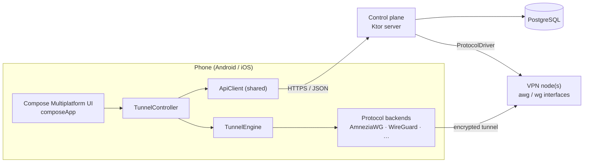

# Architecture



**Two planes.** The *control plane* (`server/`) knows accounts, devices, plans and which peer
belongs to whom. It never carries user traffic. The *data plane* is the VPN node(s): a
WireGuard-family interface the control plane programs through a `ProtocolDriver`. Today the
driver runs the `awg` / `wg` CLI on the same host. A remote node agent implements the same
interface when you add servers.

## Shared module (`shared/`)

One Kotlin source of truth for everything that crosses the network:

- `Models.kt`: every request/response type (`MeRes`, `TunnelConfig`, `StatsRes`, …)
- `Protocols.kt`: per-protocol parameter shapes (`WireGuard`, `AmneziaWG`, `Vless`)
- `ApiClient.kt`: typed client used by the apps *and* the server tests
- `Format.kt`: byte/speed/duration formatting

Compiled for JVM (server), Android and iOS.

## Protocols

The core never hard-codes a protocol. A tunnel is a `protocol` id plus two JSON objects:

| Step | Who | Data |
|---|---|---|
| 1 | device → server | `TunnelProvisionReq{protocol, serverId?, clientParams}` (non-secret, e.g. a public key) |
| 2 | server → node | `ProtocolDriver.addPeer(...)` |
| 3 | server → device | `TunnelConfig{protocol, address, dns, mtu, params}` |
| 4 | device | `TunnelEngine.start(config)` → the backend for `protocol` |

Adding a protocol touches only:

1. `shared/.../Protocols.kt`: its `ClientParams` / `ServerParams` (optional but recommended)
2. `server/.../protocols/`: a `ProtocolDriver`, listed in `AVAILABLE_DRIVERS`
3. Android: an `AndroidTunnelBackend` in `androidApp/src/<variant>/.../Backends.kt`
4. iOS: a `TunnelBackend` in `iosApp/PacketTunnel/`, listed in `PacketTunnelProvider.backends`
5. `ProtocolInfo` in the app for its display name

No table, endpoint or screen changes. The database stores protocol data in `jsonb`.

**Choosing a protocol.** The server lists each node's protocols in preference order (the
`PROTOCOLS` setting, default `amneziawg,wireguard,vless`). On "Automatic", the app picks the first one
the device can run. Users can pin one in Settings › Protocol.

### AmneziaWG (default)

[AmneziaWG](https://github.com/amnezia-vpn/amneziawg-go) is WireGuard with obfuscation against
deep packet inspection: junk packets before handshakes (Jc/Jmin/Jmax), padded messages
(S1–S4), randomised message headers (H1–H4), custom signature packets (I1–I5) and, from AWG 3,
header protection. Keys and handshake are WireGuard's, so the device sends the same
`clientParams`. `params.obfuscation` carries the node's values as awg-quick keys, passed through
verbatim so new AWG versions need no app release.

- Server-side keys (S1–S4, H1–H4, HeaderProtectionKey) must equal the node's interface config.
  `./gradlew :server:awgParams` generates a valid profile.
- With no obfuscation values AmneziaWG is wire-compatible WireGuard. So on both mobile platforms
  one library (amneziawg-android, amneziawg-apple) serves both protocols. That's also forced:
  the AmneziaWG and WireGuard libraries ship the same native library name and can't share an app.
- `jaga-custom` is a demo protocol that exists only in the simulator. It shows the plug-in path
  for a protocol whose server issues a token instead of taking a key.

### VLESS+Reality (Xray)

A second protocol on an equal footing with AmneziaWG: each node runs exactly one of them (nl1
AmneziaWG, ru1 VLESS…). People only see countries and pings; the protocol is for the app.
Shapes: `Vless` in `shared/.../Protocols.kt`; driver `server/.../protocols/VlessDriver.kt`; node
side: the agent in VLESS mode (docs/SERVER.md, "VLESS nodes"). Windows app: Xray-core in the
process behind the Wintun adapter (desktop/ARCHITECTURE.md, "VLESS+Reality").

- **No device key.** `clientParams` is `{}`. The server makes a UUID v4 per device (kept in
  `tunnels.client_params`, so moves and resyncs keep it); it is the tunnel's `peer_key`, and on
  the node both the Xray user's `id` and its `email`. A new provision (rekey) gives a new UUID.
- **Node settings** (`servers.protocols.vless`, entered in the admin panel, no secrets):
  `{host, publicKey, shortIds[], sni, fingerprint, transports: [{type: "tcp"|"xhttp", port, tag,
  flow, path?, mode?, host?}]}`. The Reality private key stays in the node's Xray config.
- **`TunnelConfig.params`** for `protocol = "vless"` (`Vless.ServerParams`):

  ```json
  {
    "uuid": "6286d380-3d9c-4118-b62e-8b761a279e20",
    "variants": [
      {"transport": "tcp", "host": "ru1.example.com", "port": 443, "flow": "xtls-rprx-vision",
       "security": "reality", "sni": "ru1.example.com", "pbk": "<Reality public key>",
       "sid": "a1b2c3d4", "fp": "firefox"},
      {"transport": "xhttp", "host": "ru1.example.com", "port": 8443, "flow": "",
       "security": "reality", "sni": "ru1.example.com", "pbk": "<Reality public key>",
       "sid": "a1b2c3d4", "fp": "firefox", "path": "/secret", "mode": "auto"}
    ],
    "endpointIps": ["203.0.113.70"]
  }
  ```

  The app tries `variants` in order (Vision on 443 first, then XHTTP) and keeps the first that
  connects. Names are the `vless://` link's query keys; `path`/`mode` only for `xhttp`, empty
  `flow` = none. `endpointIps` (optional, as for AmneziaWG) is the address the node registered
  with. `address`, `mtu` and `dns` of the TunnelConfig mean nothing to VLESS. Unknown keys must
  be ignored (new ones may come).
- **Xray client config** from one variant: outbound `vless`, `vnext[0] = {address: host, port,
  users: [{id: uuid, encryption: "none", flow}]}`, `streamSettings = {network: "raw" for tcp or
  "xhttp" (with `xhttpSettings: {path, mode}`), security: "reality", realitySettings:
  {serverName: sni, publicKey: pbk, shortId: sid, fingerprint: fp}}`.
- **Share link** (`Vless.link`, key files, other apps), exact format, one per variant:
  `vless://<uuid>@<host>:<port>?encryption=none&security=reality&pbk=<pbk>&sid=<sid>&sni=<sni>&fp=<fp>&type=<tcp|xhttp>[&flow=xtls-rprx-vision][&path=<path>&mode=<mode>]#<name>`,
  values and name percent-encoded (UTF-8, all but `A-Za-z0-9-._~`), IPv6 hosts in brackets.
- **Server list.** `GET /v1/servers?supportedProtocols=amneziawg,vless` lists VLESS nodes; without
  the parameter (every app from before VLESS) protocols in `Protocols.OPT_IN` are left out, and a
  node left with none isn't listed. Each `ServerLocation` has `countryCode` (ISO 3166-1),
  `countryName` (Russian, `servers.country_name` or the JDK's name), `protocols` (for the app,
  never shown) and `ping`: `{host, port, method}`, `tcp` = time a TCP connect to host:port (VLESS),
  `icmp` = the existing ICMP ping to host (AmneziaWG; its port is UDP).
- **Counters** come from the agent's report (Xray `statsquery`: uplink = `rx`, downlink = `tx`);
  `lastHandshake` is when the user's counters last grew. The free plan's speed limit is not applied
  on VLESS nodes (no traffic.py there).
- **Everyone's VLESS key** (issue #33, `services/VlessKeys.kt`, V18). Each user with access (the
  same rule as for AmneziaWG keys: free period not over, data not used up) has one VLESS key on top
  of the plan: a system device `devices.kind = 'vless_bonus'` (the device limit counts only
  `kind = 'device'`; users can't delete or rename it) with a tunnel on the least loaded active
  VLESS node (`max_peers` is not a cap for it). `vless_keys` keeps its UUID and link token, so the
  UUID never changes: when access ends the tunnel is dropped (the agent removes the UUID), when it
  is back the tunnel is made again; a node switched off moves it to another node. `VlessKeys.sync`
  runs at startup (backfill) and every 5 minutes, idempotent; `GET /v1/keys` with vless in
  `supportedProtocols` runs it for that user. Where it shows: `/k/<token>` of the VLESS key (page
  with links, QR, copy), `/k/<token>/vless` subscription (base64 of the `vless://` links, Vision
  first then XHTTP, named "🇫🇮 Финляндия", "🇫🇮 Финляндия 2"; headers `profile-title`,
  `profile-update-interval`, `subscription-userinfo`) which also works with the user's AmneziaWG
  key-link tokens, `/k/<token>/vless/<n>.png` and `sub.png` QR codes; `KeysRes.vless` and
  `Device.outsideLimit` only for callers sending vless in `supportedProtocols`; admin user page
  marks it "outside the limit".
- **Several locations in one key** (issue #41, `services/VlessLocations.kt`, V22). The user's UUID
  is on every VLESS node that is active and `in_subscription`: the tunnel keeps it on its own node
  (the key's home, as above), `vless_replicas` puts the same UUID on every other one
  (`VlessLocations.syncReplicas`: when a VLESS tunnel is made or moved, when the owner creates or
  edits a node, and in the 5-minute `VlessKeys.sync`). A node's agent gets tunnels and replicas in
  one peer list, so a new node gets everyone, and a node switched off or hidden loses them at once.
  Replicas go with their tunnel (`ON DELETE CASCADE`): ended access or a removed device drops the
  UUID everywhere. This holds for the apps' VLESS devices too (a new provision gives a new UUID on
  every node). Traffic on a replica counts for the device (`vless_replicas.last_*` keep its
  counters; `traffic_samples.server_id` is the node it went through).
- **Subscription** `/k/<token>/vless`: every location the UUID is on, active, `in_subscription`, and
  reporting within a day, ordered by `servers.sort_order`, then name. Names: flag + `display_name`,
  else `country_name`, else the country in Russian ("🇫🇮 Финляндия"); the backup transport is
  "🇫🇮 Финляндия (запасной)" (a third one "(запасной 2)"; `?lang=de|en` translates the suffix);
  equal names get " 2". Never a protocol name. With one VLESS node the links are those of issue #33
  but for the backup's name. Formats (`VlessSubscription`): `?format=json|singbox|clash|base64`
  wins, else the `User-Agent`: Happ (`Happ/` 1.63.1 and newer) and v2RayTun (`v2raytun`) get an
  array of full Xray configs (`XrayConfigs`, issue #59): "Авто (лучший)" first (every Vision link
  behind a `leastPing` balancer with the `observatory`), then one config per link of the base64
  list, same order and names; sing-box apps (`SFA/`, `SFI/`, `SFM/`, `SFT/`, `sing-box`) get a
  sing-box 1.12+ profile, Clash Meta clients (`clash`, `mihomo`: Clash Meta for Android, Clash
  Verge, FlClash) a mihomo profile; both have a selector "Boop VPN" with "Авто (лучший)" (`urltest`
  over every location, gstatic generate_204, 3 minutes, tolerance 50 ms) and each location, Vision
  links only (sing-box has no XHTTP, older mihomo refuses it). Everyone else (v2rayNG, Hiddify,
  which makes its own auto group from links and reads XHTTP) gets the base64 list.
  DNS and QUIC (issue #59, `SubscriptionOptions`): the Xray configs, sing-box and mihomo profiles
  resolve through the tunnel with DNS over HTTPS (`VLESS_SUB_DNS`, default
  `https://1.1.1.1/dns-query,https://8.8.8.8/dns-query`; Xray also takes the apps' port 53 queries
  into its DNS; mihomo `redir-host` with `respect-rules`; no fake DNS anywhere) and drop UDP 443
  so apps fall back to TCP (`VLESS_SUB_BLOCK_QUIC`). With `VLESS_SUB_XRAY_JSON=0` Happ and
  v2RayTun get the base64 list with a `routing` header instead: Happ a routing profile
  (`happ://routing/onadd/…`, remote DNS, `FakeDNS: false`; it cannot express ports), v2RayTun an
  Xray routing object (UDP 443 to `block`; it has no DNS header).
  Headers: `profile-title` (base64 "Boop VPN"), `profile-update-interval: 12`,
  `subscription-userinfo: upload=…; download=…; total=…; expire=…` (this month's bytes of all the
  user's devices, the monthly limit or 0, the end of access or 0), `support-url` (`SUPPORT_URL`,
  else the Telegram bot, else the website), `profile-web-page-url` (the key page).
- **Apps' list** (`GET /v1/servers?supportedProtocols=…,vless`): VLESS on a node hidden from
  subscriptions is left out; the list is in the owner's order; `countryName` is the display name
  if set. The apps show country and ping only.
- **Server-side balancer** (cascade, behind `VLESS_BALANCER=1`): a node marked *entry*
  (`cascade_role`) gets its own Xray user `cascade_uuid`, which the agents of every active *exit*
  add like any user. `GET /v1/admin/nodes/{id}/balancer` gives the entry's Xray fragment
  (`XrayBalancer`): one VLESS+Reality outbound per exit (public parameters only), a `leastPing`
  balancer over them, the rule from the entry's inbounds and the `observatory`, and before that
  rule the users' UDP 443 to a blackhole `boop-block` (`VLESS_ENTRY_BLOCK_QUIC`, on by default,
  issue #59); the owner adds it
  to the entry's config (docs/SERVER.md, "Cascade"). In subscriptions the entry comes first as
  "⚡ Авто" (its display name if set). Off (the default), the marks change nothing for users.

## Server (`server/`)

| Area | Where | Notes |
|---|---|---|
| HTTP | `http/App.kt` | Ktor routes under `/v1`, JSON errors `{error:{code,message}}`, rate limits on auth |
| Auth | `services/Auth.kt` | Email + 6-digit code (HMAC-hashed, 10 min, 5 attempts); opaque session tokens (hashed); device pairing codes |
| Plans | `services/Entitlements.kt`, `Billing.kt` | Free: 10 GB/month, 1 device. Pro: unlimited, 5 devices. Referral time stacks after paid time |
| Tunnels | `services/Tunnels.kt` | Picks a node, allocates an address, calls the driver; device limit and data limit enforced here |
| Traffic | `services/Traffic.kt` | Polls node counters → hourly per-device samples; cuts free users off at the limit |
| Stats | `services/Stats.kt` | Day/week/month buckets, time protected, sessions, per-device split |
| Owner | `services/Admin.kt` | MRR, conversion, new/cancelled subs, server capacity and warnings |
| Data | `resources/db/migration/` | Flyway SQL migrations |

**Privacy by design.** The server stores byte counts per device per hour and session start/end
times. It never stores destinations, DNS queries or user IPs (a problem report the person sends
holds what the app knows about its own connection, never keys, tokens or configs). Failure reports
(`handshake_failed`, `no_rx`) carry the node's address the app knocked on, never the user's. The connection log lives only on
the device.

**Tariffs and payments.** The owner builds tariffs in the admin panel (`services/Tariffs.kt`):
name, length in days or months, price in rubles and euros, devices, monthly data, badge, order,
status (on sale, hidden, archived; never deleted). The website, the Telegram bot and the app all
sell through our own checkout (`POST /v1/orders`, channel `web`, `telegram` or `app`); App Store
and Google Play purchases are not used. An order freezes the tariff's terms (`orders.terms`), and
`recordPaidSubscription()`, the single place a payment becomes Pro, copies them onto the
subscription, so later edits never change what someone already bought. A new purchase starts
when the current one ends, each with its own terms.

## App (`composeApp/`)

- `state/AppState`: session, API client, settings, router, tunnel controller
- `tunnel/TunnelController`: connect flow (server → protocol → clientParams → provision → start), live speed, log
- `tunnel/TunnelEngine`: platform boundary. Keys are created and kept by the engine, so shared code only sees public values
- `screens/`: one file per area, built from `ui/Kit.kt` and `theme/Theme.kt` tokens

| Platform | Engine | Storage |
|---|---|---|
| Android | `AndroidTunnelEngine` + build-time backends (AmneziaWG library, or wireguard-android fallback) | Android Keystore (AES-GCM) |
| iOS | Swift `NativeBridge` → `NETunnelProviderManager` → Packet Tunnel extension with amneziawg-apple | Keychain, shared access group |
| Desktop | `SimulatedEngine` (no traffic is routed) | Java Preferences |

## Data model

`users` · `devices` · `sessions` · `otp_codes` · `pairing_codes` · `servers` (with
`protocols jsonb`, the owner's `status` and `notice` for the apps) · `tunnels` (one per device, `protocol`, `peer_key`, `client_params jsonb`) ·
`subscriptions` (apple/google/dev/referral) · `traffic_samples` (hourly) · `connection_sessions` ·
`connection_failures` (failure reports from the apps, 30 days) · `diagnostics` (problem reports the
person sends from the app, with the end of the app's log, secrets cut out on the device; 30 days).

## Known gaps (next steps)

- Store receipt verification and server notifications (Apple, Google)
- Transactional email for sign-in codes (`Mailer` has only a console implementation)
- Remote node agent for more than one VPN server; per-node health reporting
- iOS: on-demand rules for auto-connect; App Group logs from the extension
- Android: always-on VPN guidance screen for a full kill switch; auto-connect on untrusted Wi-Fi
