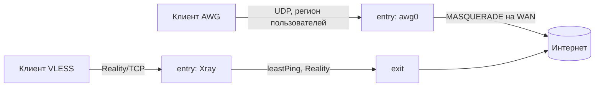
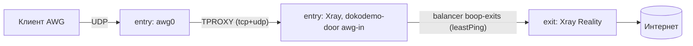
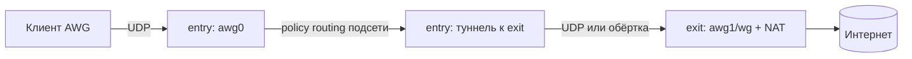
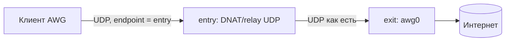

# AWG через входной сервер каскада: анализ и варианты

Документ для решения владельца. Код, ноды и конфигурация не менялись (issue #96). Используются нейтральные термины: входной сервер (entry), выходной сервер (exit), регион пользователей, цензура/DPI.

## 1. Кратко

- Сейчас AWG-трафик **никогда не попадает в каскад**: он завершается на `awg0` той ноды, куда подключён клиент, и выходит в интернет с её WAN-интерфейса через `MASQUERADE`. Каскад (Xray-балансировщик) видит только трафик собственных inbound'ов Xray.
- **Рекомендация: вариант 1** (AWG терминируется на entry, трафик из `awg0` заворачивается в Xray через `TPROXY` и уходит в существующий балансировщик `boop-exits`, то есть к exit по VLESS+Reality). Этап 0 — дешёвая диагностика (3 проверки, без кода), которая подтверждает исходную гипотезу о причине блокировки.
- Главное допущение: AWG плохо работает из-за фильтрации на пути «клиент → зарубежный адрес», а не из-за самого протокола. Если окажется, что плечо entry→exit тоже режет UDP, выигрывает вариант 1 (плечо маскируется под TLS), а варианты 2 (голый туннель) и 3 (релей UDP) теряют смысл.

## 2. Проверка фактов по коду

| Утверждение из задачи | Результат | Где в коде |
|---|---|---|
| Каскад: `cascade_role` entry/exit, `servers.cascade_uuid` | Верно. Роль ставится в `Nodes.kt` (`UPDATE servers SET cascade_role=?, cascade_uuid=coalesce(cascade_uuid, ?)`), столбцы добавлены миграцией `V22__vless_locations.sql`. | `services/Nodes.kt` (≈ стр. 375–390), `V22__vless_locations.sql` |
| Агенты exit добавляют UUID entry как обычного пользователя | Верно, только при `VLESS_BALANCER=1` и только для VLESS-нод: `NodePeer(cascade_uuid, CASCADE_ADDRESS)` добавляется к списку пользователей exit. | `services/Nodes.kt` (≈ стр. 650–660) |
| Фрагмент конфига entry собирает `XrayBalancer` | Верно: outbound `boop-exit-<id>` (VLESS+Reality, Vision, иначе XHTTP) на каждый exit, балансировщик `boop-exits` (`leastPing`), `observatory` (проба раз в минуту), blackhole `boop-block` и правило «UDP 443 → `boop-block`» (`VLESS_ENTRY_BLOCK_QUIC`, по умолчанию вкл.), затем правило «inboundTag entry → balancerTag». | `services/XrayBalancer.kt` |
| Правило балансировщика привязано к inbound'ам entry | Важная деталь: `inboundTag` берётся из `entry.transports.map { it.tag }` — то есть **только теги VLESS-inbound'ов** (`vision`, `xhttp`). Чужой inbound в балансировщик сам не попадёт. | `Nodes.kt` (`XrayBalancer.fragment(entry.transports.map { it.tag }, …)`), `docs/SERVER.md`, «Cascade» |
| Фрагмент вливается вручную | Верно (шаг 3 раздела «Cascade»), `xray run -test` и `systemctl restart xray`. | `docs/SERVER.md` стр. 203–250 |
| Агент v3 сообщает выбранный exit | Верно: `xray api bi -json boop-exits`, нужен `RoutingService` в `api.services`. | `resources/node/agent.py` (класс состояния балансировщика), `ServersOverview.kt` |
| `install.sh` поднимает `awg0`/`wg0`, `ip_forward`, `MASQUERADE` на WAN | Верно: `net.ipv4.ip_forward=1`, в `PostUp`: `iptables -t nat -A POSTROUTING -s <подсеть> -o <WAN> -j MASQUERADE` и `FORWARD ACCEPT` в обе стороны. Порт и подсеть выдаёт панель при регистрации. | `resources/node/install.sh` стр. 171–195 |
| Параметры обфускации — `AwgParams.kt`, профиль 3.1 | Верно. В конфиг сервера не пишутся `I1–I5` (подпись первого пакета — только у клиента). | `protocols/AwgParams.kt`, `install.sh` стр. 196–198 |
| Туннель привязан к ноде, конфиг строится из параметров ноды | Верно. `WgFamilyDriver.params()` отдаёт публичный ключ ноды, `endpoint`, `AllowedIPs = 0.0.0.0/0, ::/0`, keepalive, обфускацию; `MTU` берётся из `servers.mtu`. Статичный конфиг собирает `AmneziaWG.quickConfig`. | `protocols/WireGuardDriver.kt`, `services/Tunnels.kt` (`mtu = server.int("mtu")`), `services/Keys.kt`, `shared/.../api/Protocols.kt` стр. 97–114 |
| Подсказка `endpointIps` | Верно: добавляет IPv4 в параметры, меняет версию туннеля; хост и обфускация не трогаются. | `services/EndpointHint.kt` |

### Уточнения и то, что упущено

1. **Одна установка `install.sh` = один протокол.** Режим `PROTOCOL=vless` ставит только агента (Xray настраивается вручную) и завершается `exit 0` до блока AWG; AWG-ветка никогда не ставит Xray. Поэтому «entry, который одновременно VLESS-вход и AWG-нода» — это либо два узла (две регистрации, два `NODE_TOKEN`, две службы агента на одной машине — установщик одной машины второй раз такого не предусматривает), либо ручная конфигурация. **Допущение:** на entry сейчас стоят и Xray, и `awg0`, хотя из кода это не следует; точный провижининг надо подтвердить у владельца перед этапом 1.
2. **Путь AWG-трафика на entry.** Клиент → UDP на порт `awg0` → расшифровка в `amneziawg-go` (userspace) → пакет появляется на интерфейсе `awg0` с адресом клиента из подсети ноды → ядро маршрутизирует (`FORWARD`) → `POSTROUTING MASQUERADE` на WAN → интернет с адреса entry. Xray в этом пути не участвует: его правила маршрутизации срабатывают только для трафика его собственных inbound'ов, а пакеты `awg0` Xray вообще не видит. То есть предположение задачи «наружу напрямую с entry, мимо exit» **подтверждается по коду**, при условии допущения выше.
3. **Учёт и лимиты завязаны на `FORWARD`.** `traffic.py` вешает цепочку `BOOP_CLASSIFY` на `FORWARD` по `-i/-o <IFACE>`, считает байты на адрес устройства (`BOOP_RX`/`BOOP_TX`, mangle) и режет скорость бесплатного тарифа через `tc htb` на самом `IFACE`. Всё, что **не проходит `FORWARD`** (TPROXY, REDIRECT, трафик в локальный сокет), из счётчиков выпадет — это прямое следствие для вариантов 1 и 3.
4. **Онлайн-IP** берутся из `awg show dump` (endpoint пира, `WgFamilyDriver.parseDump` → `ClientIps.hostOf`). В вариантах 1 и 2 клиенты по-прежнему подключаются к entry, и учёт не меняется. В варианте 3 на exit endpoint будет адресом entry.
5. **Основной сервер панели никогда не нода.** Во всех вариантах меняются только entry/exit; панель лишь хранит настройки.
6. **Выбор exit балансировщиком** отражается только в статусе агента (`agent.py`); у AWG такого поля нет, это нужно будет добавить (см. раздел 5).

## 3. Схемы

Сейчас (AWG мимо каскада):

Вариант 1:

Вариант 2:

Вариант 3:

## 4. Варианты

### Вариант 1. AWG на entry, выход через существующий Xray-каскад

**Как работает.** Клиент остаётся на entry с теми же ключами. Исходящий трафик подсети `awg0` перехватывается в `mangle/PREROUTING` правилами `TPROXY` (TCP и UDP) в `dokodemo-door` inbound Xray с тегом, например, `awg-in` (`followRedirect`, `sockopt.tproxy = "tproxy"`), плюс `ip rule fwmark … lookup 100` и `ip route add local 0.0.0.0/0 dev lo table 100`. Тег `awg-in` добавляется в `inboundTag` правил фрагмента (сейчас там только теги VLESS-inbound'ов), после чего трафик попадает в то же правило «UDP 443 → blackhole», затем в балансировщик `boop-exits` с `observatory`. На entry нужен `sniffing` не обязательно; DNS клиента (`DNS =` в конфиге) уходит вместе с остальным UDP.

**Где встраивается.**
- `install.sh`: после `awg-quick` — правила TPROXY и policy routing в `PostUp`/`PostDown` (с откатом), только при включённом флаге (`AWG_VIA_XRAY=1` в `/etc/jaganet/env`/`node.json`); исключения: порт самого `awg0` и адреса exit (чтобы не зациклить).
- `XrayBalancer.fragment`: параметр с дополнительными `inboundTag` (`awg-in`) и сам inbound `dokodemo-door` в фрагменте (сейчас фрагмент не содержит inbound'ов; их можно добавить как отдельный ключ или выдавать отдельным блоком). Вливание остаётся ручным, как сейчас.
- Конфиги клиентов, ключи, `Tunnels.kt`/`Keys.kt`: **без изменений**.
- Агент/панель: роль «AWG via entry» как признак ноды (флаг рядом с `cascade_role`, аддитивная миграция — в будущей задаче, не здесь).

**DPI.** Клиент→entry: тот же AWG 3.1, но внутри региона (для такого трафика гипотеза автора — блокировки именно на зарубежное направление). Entry→exit: **VLESS+Reality** по TCP 443 — тот же профиль, что уже работает для VLESS-каскада; межсерверный трафик неотличим от обычного TLS-рукопожатия с выбранным SNI. Маскировка плеча уже есть и проверена продакшеном.

**Накладные расходы.**
- MTU: Xray терминирует L4 (TCP-поток и UDP-датаграммы), а не IP-пакеты, поэтому вложенной инкапсуляции IP-в-IP нет и `servers.mtu` (MTU клиентского туннеля AWG) на плече entry→exit не влияет. Это главное преимущество перед вариантом 2.
- UDP внутри TCP: UDP-датаграммы клиентов (игры, голос, не-QUIC) идут по Reality-TCP через XUDP/UDP-over-TCP. Возможен «TCP meltdown» при потерях; для TCP-трафика (основная масса) проблемы нет. QUIC блокируется правилом `boop-block`, приложения откатываются на TCP (это поведение уже есть в каскаде).
- CPU/канал entry: трафик проходит дважды (расшифровка AWG в userspace + Xray); entry становится узким местом. Нужна оценка по тесту (нагрузка на 1 пользователе недостаточна, нужен тест ≥ 20 параллельных).
- ICMP не проксируется Xray: `ping` через туннель перестанет работать (на entry разрешить/отвечать локально или оставить).

**Отказоустойчивость.** Переиспользуются `boop-exits`/`leastPing`/`observatory` без изменений. При переключении exit активные TCP-соединения рвутся (как у VLESS-каскада), новые идут через нового; UDP-«сессии» XUDP восстанавливаются приложениями.

**Совместимость.** Полная: ключи, конфиги, `/k/{token}`, endpoint, обфускация, десктоп Boop 1.4.x/1.5.x, мобильные Boop и сторонние AWG-клиенты не меняются. Миграция не нужна. Сломается только то, что полагается на `FORWARD`: см. учёт ниже.

**Что меняется в панели/агенте.**
- Учёт (`traffic.py`): добавить счётчики в `mangle/PREROUTING` по `-i awg0` для upload; download считается на `awg0` OUTPUT (локальный сокет Xray → `awg0`), `tc htb` на `IFACE` продолжает резать download. Нужна правка `setup()` и `counters()` (аддитивная, под флагом).
- Лимит скорости: download — как сейчас (egress `awg0`); upload (ingress) режется только если добавить `ifb`/`police`; на текущей реализации upload не режется, значит поведение не регрессирует.
- Онлайн-IP: без изменений. Статус-страница: добавить выбранный exit для AWG-туннелей (поле балансировщика уже есть в агенте v3, но привязано к VLESS).
- **Различимость пользователей на exit:** exit видит одного пользователя (`cascade_uuid` entry). Потолок скорости/учёт на exit по пользователям не работает, но это уже так для VLESS-каскада; учёт остаётся на entry.

**Мониторинг.** `observatory` уже проверяет пробы по exit; добавить в агент проверку «в `awg-in` есть соединения» и пробу через `awg0` (HTTP-запрос с адреса из подсети через TPROXY). Отдельная метрика «цепочка жива» по `xray api bi`.

**Приватность.** На entry (в регионе пользователей) видны IP клиентов (handshake), метаданные соединений (conntrack). Требуется: `access` лог Xray выключен, `loglevel warning`, conntrack без долгого хранения, `client_ips` — как сейчас (7 дней, только адрес и время). Содержимое HTTPS не видно, DNS-запросы клиентов видны entry, если не шифровать их (DoH на клиенте) — **риск выше, чем сейчас** (раньше DNS видел тот же entry, но без записи в сторонний процесс).

**Объём работ.** 4 этапа (см. раздел 7), средняя сложность; основные риски: TPROXY+userspace `awg0` (нужно проверить, что `amneziawg-go` и `TPROXY` дружат с `PREROUTING` на интерфейсе TUN — проверяется на тестовой ноде), потеря учёта при ошибке в правилах, CPU entry.

### Вариант 2. AWG на entry, отдельный межсерверный туннель до exit

**Как работает.** На entry второй интерфейс (`awg1`/`wg1`/другой туннель) к exit; подсеть клиентов AWG маршрутизируется в него policy routing'ом (`ip rule from <подсеть> table 200`, `default dev awg1`), NAT и `ip_forward` на exit. Переключение между exit — по health-check своим скриптом (нет готового `leastPing`).

**DPI.** Entry→exit — снова UDP AWG/WG на зарубежный адрес, то есть ровно то, что предположительно режется. Помогает только если плечо между серверами менее фильтруется, чем клиентское (допущение, проверяется этапом 0). Маскировка плеча требует обёртки (udp2raw/Xray/TLS-обёртка UDP), то есть UDP в TCP со всеми проблемами и вложенным MTU.

**Накладные расходы.** Двойная инкапсуляция: MTU клиента 1280–1380 → внутренний туннель ещё −60…−80 байт → фрагментация/снижение MTU обязательны (`servers.mtu`, MSS clamping). Задержка +1 плечо. Пропускная способность entry — на оба плеча. При обёртке в TCP — TCP-meltdown для всего трафика, не только UDP.

**Отказоустойчивость.** Нужен собственный health-check; несколько exit → таблица маршрутов и балансировка (ECMP/скрипт). Активные сессии рвутся при смене exit (меняется NAT-адрес).

**Совместимость.** Клиентские ключи и конфиги не меняются (как в варианте 1). Но на exit появляется новый «пир» (entry), нужна его выдача/ротация: это новый тип сущности в панели (ключи нод между собой), которого в коде нет.

**Панель/агент.** Новая сущность «межсерверный туннель», генерация ключей, раздача на обе стороны через агентов, учёт на entry сохраняется (трафик проходит `FORWARD`). Мониторинг — рукопожатия `awg show`.

**Приватность.** Как в варианте 1 плюс постоянный межсерверный туннель с известными ключами.

**Объём работ.** Самый большой: новая сущность в панели, миграции, агент, health-check, обёртка для маскировки.

### Вариант 3. UDP-релей/DNAT на entry к AWG на exit

**Как работает.** Клиентский endpoint — entry; entry пробрасывает UDP-порт на AWG-порт exit (`DNAT`+`MASQUERADE`, `socat`, или userspace-релей). Ключи и обфускация — те, что на exit (клиент говорит с exit «сквозь» entry).

**DPI.** Плечо entry→exit — те же AWG-пакеты, идущие через границу без маскировки; если проблема именно в пересечении границы, вариант не решает ничего. Если проблема — только в «клиентском провайдере → зарубежный адрес» и между датацентрами UDP не режут, вариант самый дешёвый и быстрый.

**Накладные расходы.** Минимальные: нет повторной инкапсуляции, нет повторного шифрования на entry (только пересылка), MTU не меняется (как и сейчас, endpoint другой).

**Отказоустойчивость.** Нет: у клиента один endpoint и ключ одного конкретного exit. Переключение на другой exit с другим серверным ключом без перевыдачи конфига невозможно; при падении exit туннели просто не работают.

**Совместимость.** Клиент по-прежнему имеет ключ exit. Для уже выданных конфигов на exit достаточно подменить `Endpoint` (через `EndpointHint.endpointIps` для приложений, которые его понимают; статичные конфиги `/k/{token}` придётся скачать заново). Один туннель — один exit: ключи не переносимы между нодами.

**Панель/агент.** Онлайн-IP и «последний IP»: на exit источник пакетов — entry, `client_ips` теряются (если нет передачи реального IP через PROXY-подобный заголовок, чего у UDP нет); для восстановления нужен учёт на entry (conntrack). Трафик/лимиты считаются на exit как сейчас (`FORWARD` есть).

**Приватность.** Entry видит IP клиентов и объёмы, но не содержимое (шифрование end-to-end до exit): **лучший вариант по приватности**.

**Объём работ.** Малый, но с большим риском «не помогло»: диагностика этапа 0 решает.

### Вариант 4 (комбинация). 1 по умолчанию, 3 как быстрый тест

Вариант 3 стоит использовать **не как решение, а как диагностику** (этап 0): подняв временный DNAT на тестовой паре, за час выясняется, режется ли UDP на плече entry→exit. Результат определяет, нужен ли вариант 1 (маскировка).

## 5. Что меняется в панели и агенте (сводка)

| Область | Вариант 1 | Вариант 2 | Вариант 3 |
|---|---|---|---|
| Роль ноды | флаг «AWG via entry» | новый тип межсерверного туннеля | флаг «relay» + цель |
| `install.sh`/агент | TPROXY + policy routing под флагом | второй интерфейс, маршруты, health-check | DNAT/relay |
| `XrayBalancer.fragment` | добавить inbound `awg-in` и тег в правила | — | — |
| Клиентские конфиги/ключи | без изменений | без изменений | endpoint → entry (ключи exit) |
| Учёт трафика (`traffic.py`) | правки: PREROUTING/OUTPUT | без изменений | на exit как сейчас |
| Лимит скорости (`tc`) | download как сейчас | как сейчас | как сейчас |
| Онлайн-IP | без изменений | без изменений | теряются на exit |
| Статус-страница | выбранный exit для AWG | состояние туннеля | состояние релея |

## 6. Сравнительная таблица

| Критерий | 1. TPROXY → Xray-каскад | 2. Межсерверный туннель | 3. UDP-релей |
|---|---|---|---|
| Маскировка плеча entry→exit | Да (VLESS+Reality) | Нет, либо обёртка | Нет |
| Вероятность обхода DPI | Высокая | Средняя / зависит от обёртки | Только если граница не режет UDP |
| MTU/фрагментация | Нет вложенного IP-туннеля | Двойная инкапсуляция | Как сейчас |
| UDP поверх TCP | Да для не-TCP-трафика (XUDP) | Да при обёртке | Нет |
| Нагрузка CPU entry | Высокая (AWG + Xray) | Высокая | Низкая |
| Балансировка/failover | Готово (`leastPing`) | Свой скрипт | Нет |
| Сохранение ключей/конфигов | Полное | Полное | Только с заменой endpoint |
| Учёт/лимиты | Нужны правки `traffic.py` | Без правок | Онлайн-IP теряются |
| Приватность entry | Entry видит метаданные | Entry видит метаданные | Entry видит только IP/объём |
| Объём работ | Средний (4 этапа) | Большой | Малый |
| Главный риск | TPROXY + `amneziawg-go`, CPU | Новая сущность, MTU | «Не помогло» |

## 7. Рекомендация и поэтапный план

**Рекомендуется вариант 1**, этап 0 — диагностика вариантом 3. Обоснование: единственный, где плечо через границу уже маскируется и проверено в продакшене; сохраняет ключи и конфиги; переиспользует балансировщик и мониторинг. Минус (учёт, CPU) закрывается этапами 2–3.

Каждый этап — отдельная будущая задача.

- **Этап 0. Диагностика (без кода).** Вручную на тестовой паре entry/exit: (а) AWG-клиент из региона → entry → интернет: подтвердить, что поток работает (или нет) на плече клиента; (б) iperf/UDP-проба entry↔exit без маскировки: режет ли UDP граница; (в) DNAT-релей (вариант 3) на временном порту. Решение: если (б) показывает потери, вариант 1 обязателен; если нет, возможен более простой вариант 3.
- **Этап 1. Прототип на одной тестовой ноде и одном устройстве.** Ручное добавление `dokodemo-door` и TPROXY на тестовом entry; один тестовый пользователь; сравнение скорости, задержки, потерь и нагрузки на CPU. Критерий: трафик тестового пользователя виден в выбранном exit (`xray api bi`), у остальных ничего не меняется.
- **Этап 2. Код под флагом.** `XrayBalancer.fragment` с `awg-in`, правки `install.sh` (TPROXY в `PostUp/PostDown`, под флагом, по умолчанию выключен), правки `traffic.py`; тесты на `XrayBalancer` и юнит-тесты правил.
- **Этап 3. Панель и мониторинг.** Признак ноды, статус выбранного exit для AWG, проба цепочки, документация в `docs/SERVER.md`.
- **Этап 4. Нагрузочный тест и постепенное включение.** Сначала пользователи с флагом, потом остальные.

**Откат.** Флаг выключается, `PostDown` удаляет правила TPROXY и policy routing, `systemctl restart awg-quick@awg0` возвращает прямой `MASQUERADE`. Конфиги клиентов не менялись, перевыдавать ничего не нужно. Фрагмент Xray откатывается удалением `awg-in` и тега из правил (как для каскада в `docs/SERVER.md`).

## 8. Допущения

1. На entry действительно работает и AWG (`awg0`), и Xray; из кода (`install.sh`: один протокол на установку) это не следует.
2. Причина проблем с AWG — фильтрация на пути «клиент → зарубежный адрес»; плечо между серверами либо не фильтруется (вариант 3 достаточен), либо фильтруется (нужен вариант 1). Проверяется этапом 0.
3. `amneziawg-go` создаёт обычный TUN-интерфейс, и `TPROXY` в `PREROUTING` для него применим; не проверялось (нет стенда).
4. Параметры обфускации AWG и семантика ключей не меняются ни в одном варианте.
5. Пропускная способность и CPU entry оценены качественно; цифр нет.
