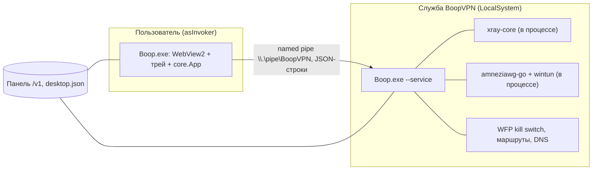

# Windows-клиент Boop: варианты новой архитектуры и стека

Предложение к issue #74. Код клиента не менялся. Документ описывает текущее состояние,
2–4 варианта целевой архитектуры, сравнение, рекомендацию и поэтапный план.

## 0. Допущения

Вопросы задавать было некому, поэтому принято следующее.

* Подпись кода появится (облачная подпись, `BOOP_SIGN`, см. `desktop/SIGNING.md`) и будет
  покрывать **все** исполняемые файлы дистрибутива, а не только `Boop.exe`.
* Какой именно антивирус что сочтёт подозрительным, проверить здесь нельзя. Оценки
  «риск детекта» ниже — экспертные, по известным эвристикам поведенческих модулей
  (служба SYSTEM из недоверенного файла, смена владельца каталогов, самораспаковка DLL,
  самозамена exe, частые вызовы `schtasks.exe`). Любой вариант нужно проверять на
  Kaspersky, Defender и ESET до выбора окончательного пути.
* Протокол панели `/v1`, формат подписки, конфиги VLESS/xray и AmneziaWG (в том числе
  обфускация) и поведение нод не меняются.
* Целевая ОС — Windows 10 1809+ и Windows 11, x64 (ARM64 — по возможности).
* Оценки объёма работ — в человеко-неделях одного разработчика, ориентировочные.

## 1. Текущая архитектура и слабые места

### Что есть сейчас (1.4.4)

Один и тот же `Boop.exe` — это и окно, и служба, и установщик службы
(`--install-service`, `--remove-service`, `--autostart-on`), и самообновляемый файл.
Единственный внешний бинарь — `wintun.dll`, вшитый в exe через `go:embed`
(`desktop/main_windows.go`) и распаковываемый рядом с программой
(`desktop/winsvc/service_windows.go`, `desktop/winsvc/install.go`).

### Слабые места (по файлам)

| # | Проблема | Где | Почему это видит антивирус |
|---|---|---|---|
| 1 | Неподписанный exe сам ставит службу LocalSystem | `winsvc/install.go` (`Install`), `winsvc/system_windows.go` (`CreateService`) | Классический признак дроппера/бэкдора: недоверенный файл → служба SYSTEM с автозапуском |
| 2 | Смена владельца и DACL каталогов через `SeRestorePrivilege`/`SeTakeOwnershipPrivilege` | `winsvc/system_windows.go` (`enablePrivilege`, `SecureDir`) | Включение привилегий обхода прав — поведение, типичное для вредоносов и «лечилок» |
| 3 | Распаковка DLL из ресурсов рядом с exe, включая «Загрузки» при запуске без установки | `main_windows.go` (`wintunDLL`), `winsvc/service_windows.go` (~190) | Самораспаковка исполняемого кода рядом с собой |
| 4 | Скрытый `schtasks.exe` при каждом старте и правка реестра | `winsvc/system_windows.go` (~357–361, `hidden("schtasks.exe", …)`), `MigrateAutostart` | Запуск скрытых системных утилит и повторяющаяся запись в автозапуск |
| 5 | Самообновление: служба скачивает и подменяет собственный `Boop.exe`, затем перезапускает себя | `helper` (`update`), `winsvc/install.go` (`.old`/`.new`) | Самомодификация исполняемого файла службы |
| 6 | В одном процессе xray-core и amneziawg, `-H windowsgui` | `desktop/vpn/xray`, `desktop/vpn/windows.go`, `build.sh` | Сигнатуры «xray-клиентов» (Happ, v2rayN уже получали `PDM:Trojan.Win32.Generic`); GUI-подсистема + сетевой код + привилегии |
| 7 | Сложная миграция/установка в самом exe, 1.4.0 сломалась на установке службы | `winsvc/install.go` (`Need`, `Install`, `MigrateAutostart`), `docs/CHANGELOG-1.4.1.md` | Не антивирусная, а инженерная: логика установки нельзя починить без выпуска нового exe, который сам же её и исполняет |
| 8 | Нет доверенной подписи | `SIGNING.md` | «Неизвестный издатель», репутация SmartScreen с нуля на каждую сборку |

Хорошее, что стоит сохранить: непривилегированное окно (`asInvoker`), типизированный
IPC без запуска чужих путей и команд, ACL на pipe (`helper.PipeSDDL`), хранение токена
через DPAPI, Inno-установщик (`desktop/installer/boop.iss`) как отдельная точка входа,
проверка SHA-256 манифеста.

Принципиальный вывод: в 1.4.x архитектура процессов (окно ↔ служба по pipe) уже
правильная. Плохо не разделение, а **кто и как устанавливает**: установочная логика,
права, автозапуск и обновление живут внутри недоверенного exe. Поэтому смена UI-стека
сама по себе проблему детектов не решает — это второстепенный выбор.

## 2. Варианты

Общие для всех вариантов принципы (это ядро предложения, стек — вторичен):

1. **Установщик владеет системными изменениями**: каталог, ACL, служба, автозапуск,
   удаление. Приложение и служба их не выполняют и не просят привилегий для этого.
2. **Подписаны все бинарники** (UI, служба, ядра, драйверный DLL, установщик).
3. **Автозапуск только у установленной копии** (`%ProgramFiles%\Boop`), копии из
   «Загрузок» ничего не регистрируют.
4. **Нет самораспаковки и подмены своего exe**: файлы лежат на диске как положено.
5. **Нет скрытых вызовов `schtasks`/`reg`/`powershell`** при обычной работе.

### Вариант A. «Оставить Go + WebView2, перенести установку в установщик» (эволюция)

* **Стек UI.** Без изменений: Go + `go-webview2` + текущий `ui/`, трей на Win32.
* **Процессы.** Три файла вместо одного: `Boop.exe` (UI, `asInvoker`, GUI-подсистема),
  `BoopService.exe` (служба, консольная подсистема, без UI-кода и без WebView2),
  опционально `BoopUpdater.exe` (маленький, только обновление). Общий протокол `helper/`
  остаётся. Служба как сейчас — LocalSystem, но регистрируется установщиком, а у
  службы права на каталог уже выданы и не меняются кодом.
* **Ядра.** xray и amneziawg остаются встроенными в `BoopService.exe` (одна Go-сборка).
  `wintun.dll` лежит файлом, подписан (подпись WireGuard LLC сохранить), не
  распаковывается кодом.
* **Установка/обновление/удаление.** Inno Setup (уже есть) делает всё: `sc create`
  через секцию `[Run]`/`[Code]` либо встроенная в Inno регистрация, ACL — директивой
  `Permissions:` секции `[Dirs]`, автозапуск — `[Registry]` в HKLM Run или ярлык в
  «Автозагрузке» установленной копии. Из кода удаляются `SeRestore`/`SeTakeOwnership`,
  `schtasks`, `--install-service`/`--autostart-*`, самораспаковка. Обновление:
  UI скачивает новый `Boop-Setup-x.y.z.exe`, проверяет sha256 из `desktop.json` и подпись
  и запускает его (`/SILENT /CLOSEAPPLICATIONS`) — один UAC; служба сама себя не
  подменяет.
* **Антивирусы/SmartScreen.** Исчезают поведенческие триггеры 2–5. Остаётся 6
  (сигнатуры xray в Go-бинарнике): снижается подписью и разделением — детект на
  большом GUI-exe с WebView2 меньше, чем на «службе с xray» при самоустановке.
  Репутацию SmartScreen копит подпись установщика и сертификат издателя.
* **Совместимость.** API панели, подписка, `desktop.json` (sha256 указывает на
  `Boop-Setup`, а не на `Boop.exe` — потребуется поле `kind`/отдельный манифест, старые
  клиенты читают `Boop.exe` как раньше). Миграция с 1.4.x: установщик останавливает
  службу, заменяет файлы, регистрирует службу, токены (`%LOCALAPPDATA%\Boop`) и
  `last.json` не трогаются. Для 1.4.x, у которых самообновление подменяет `Boop.exe`,
  выпускается переходный релиз, который при следующем обновлении скачивает именно
  установщик.
* **Размер/ОС.** ~25–35 МБ (как сейчас + служба), Windows 10 1809+, нужен WebView2 Runtime
  (ставит установщик).
* **Объём работ.** 3–5 недель, низкий риск регрессий в VPN-логике.
* **Риски.** WebView2 остаётся зависимостью; xray-сигнатуры не исчезают; один язык —
  без выигрыша в экосистеме UI.
* **macOS/Linux.** Linux уже есть (WebKitGTK + `boop-helper`). macOS: Go-ядро
  переиспользуется, нужен WKWebView-хост и утилита `utun`; осуществимо.

### Вариант B. Go-ядро как подписанный сервис + UI на .NET (WinUI 3 или WPF)

* **Стек UI.** .NET 8 (LTS) + WPF (проще, есть везде) или WinUI 3 (современнее, но
  тяжелее деплой). Рекомендуем WPF/MVVM с тем же `UIState`, переданным как JSON по pipe.
* **Процессы.** `Boop.exe` — нативный .NET UI, без Go. `BoopService.exe` — Go-служба
  (то, что сейчас в `core`/`vpn`/`helper`, без UI). Контракт между ними — текущий
  протокол pipe, расширенный командами `state`/`call` (логика `core.App` переезжает
  в службу или остаётся в отдельном Go-процессе `boop-core`).
* **Ядра.** Как в А: встроены в Go-службу, либо вынесены в подписанные `xray.exe` и
  `awg-service.exe` рядом (запуск службой по абсолютному пути из защищённого каталога).
* **Установка/обновление.** MSIX (если принять ограничения службы в контейнере — для
  VPN-драйвера MSIX неудобен) или WiX/Inno. Рекомендуем WiX 4 (MSI) для корпоративной
  дружелюбности и «чистого» следа в системе, либо оставить Inno.
* **Антивирусы/SmartScreen.** Нативный .NET-UI «чище» с точки зрения эвристик (меньше
  Go-рантайма в GUI-процессе); сервис остаётся в Go. Выигрыш — в UI-процессе, не в сервисе.
* **Совместимость.** Протокол панели тот же; требует переписать окно (~4.3 тыс. строк
  Go + `ui/` HTML/JS) и хост трея/тостов. Миграция настроек: читать `%LOCALAPPDATA%\Boop`.
* **Размер/ОС.** Framework-dependent: +~1 МБ, но нужен .NET Desktop Runtime (ставит
  установщик); self-contained: +60–80 МБ. Windows 10 1607+ для WPF.
* **Объём работ.** 8–12 недель (переписать UI и мост, тосты, трей, обновление).
* **Риски.** Два языка, двойная локализация, разъезд UI и ядра; потеря общей кодовой
  базы с Linux-клиентом; DPAPI/токен-хранилище переписать.
* **macOS/Linux.** .NET UI на них не переносится (MAUI/Avalonia — отдельный проект).

### Вариант C. Tauri (Rust) + Go-служба

* **Стек UI.** Tauri 2: WebView2 и существующий `ui/` (HTML/CSS/JS) почти без изменений;
  Rust-оболочка вместо Go-хоста (окно, трей, автозапуск-плагин, тосты).
* **Процессы.** UI-процесс (Tauri, `asInvoker`) + Go-служба по pipe — как в B.
* **Ядра.** Как в А/B.
* **Установка/обновление.** Tauri bundler даёт NSIS/MSI; встроенный updater с подписью
  минисайном. Служба ставится установщиком (NSIS/WiX-хуки).
* **Антивирусы/SmartScreen.** Rust-бинарники иногда вызывают ложные срабатывания на
  уровне «неизвестный Rust-exe», но вместе с подписью это ниже, чем у Go с xray в
  GUI-процессе. Реальный выигрыш — тот же, что и у B: UI-процесс без сетевого ядра.
* **Совместимость.** `ui/` переиспользуется; мост `window.boop`/`call` переписывается на
  Tauri commands/events. Обновление: нужно сопоставить с `desktop.json` (sha256), так как
  встроенный updater Tauri использует свой манифест.
* **Размер/ОС.** UI ~5–10 МБ, общий дистрибутив ~30 МБ; WebView2 Runtime как сейчас.
* **Объём работ.** 6–9 недель (Rust-оболочка, трей, тосты, DPAPI, обновление).
* **Риски.** Новый язык (Rust) в команде; для macOS/Linux Tauri хорош, но служба там своя.
* **macOS/Linux.** Лучшая переносимость UI из вариантов с переписыванием: macOS/Linux
  нативно, `ui/` общий.

### Вариант D. Wails (Go) + WebView2 вместо ручного `go-webview2`

Рассмотрен и **отклонён как самостоятельный**: даёт тот же стек, что в А (Go + WebView2),
только с более тяжёлым фреймворком вместо уже работающего `go-webview2`. Выигрыша для
проблем антивирусов нет, поэтому отдельным пунктом не оформлен. Flutter Desktop тоже не
рассматривается: требует полной переписи UI, не даёт преимуществ по детектам и тянет
Dart/Skia-рантайм (~20 МБ).

## 3. Сравнение

| Критерий | A: Go+WebView2, установка вынесена | B: .NET UI + Go-служба | C: Tauri + Go-служба |
|---|---|---|---|
| Снятие поведенческих триггеров (1–5) | полное | полное | полное |
| Снятие сигнатур xray в UI-процессе (6) | частичное (в службе остаются) | да в UI | да в UI |
| Изменение кода | малое | большое | среднее |
| Объём работ | 3–5 нед. | 8–12 нед. | 6–9 нед. |
| Риск регрессии VPN-логики | низкий | средний | средний |
| Размер установщика | ~30 МБ | 30–100 МБ | ~30 МБ |
| Зависимости | WebView2 | .NET Runtime | WebView2 |
| Переносимость на macOS/Linux | хорошая (Go уже есть) | слабая | хорошая |
| Новые языки для команды | нет | C# | Rust |
| Сохранение `ui/` | полное | нет | почти полное |
| Миграция с 1.4.x | простая | сложная | средняя |
| Подпись и SmartScreen | один набор бинарников | два рантайма | два рантайма |

## 4. Рекомендация

**Вариант A, с переходом к C только если после A остаются детекты на UI-процессе.**

Обоснование:

1. Корень проблем — *кто устанавливает и как*, а не язык UI. A устраняет все пять
   поведенческих триггеров (1–5), которые, судя по описанию в #74, и вызывают удаление
   Kaspersky System Watcher.
2. A — самый дешёвый и безопасный: VPN-логика, протокол pipe и `ui/` не меняются.
3. Разделение GUI-процесса и службы на два файла (A) убирает xray/amneziawg из
   GUI-exe — это уже даёт большую часть пользы B/C без переписывания окна.
4. Если после A и подписи детекты остаются, UI можно заменить на Tauri (C) отдельным
   этапом, не трогая службу: интерфейс между ними (pipe-протокол) фиксируется в этапе 2.

### План миграции по этапам (каждый этап — отдельная будущая задача)

1. **Измерение и база.** Прогнать текущую сборку через Kaspersky/Defender/ESET (VM),
   зафиксировать, какие именно срабатывания. Заодно получить подпись (`BOOP_SIGN`) и
   проверить, как меняется репутация. Результат — таблица «что триггерит». *~0,5 нед.*
2. **Разделение бинарников.** Вынести службу в `BoopService.exe` (нет WebView2, нет UI),
   `Boop.exe` — только окно/трей. Зафиксировать pipe-протокол как версионируемый
   интерфейс (поле `proto`). Подписать оба. *~1 нед.*
3. **Установка только установщиком.** Перенести в Inno: каталог/ACL (`Permissions:`),
   регистрацию службы, автозапуск установленной копии, удаление. Удалить из кода
   `SecureDir`/`enablePrivilege`, `--install-service`, `--autostart-*`, `schtasks`,
   самораспаковку `wintun.dll`. Копия вне `%ProgramFiles%` работает только как
   «портативный режим без службы» и ничего не регистрирует. *~1,5 нед.*
4. **Обновление через установщик.** UI скачивает `Boop-Setup`, проверяет sha256 и
   подпись, запускает тихо. Служба перестаёт подменять свой exe. Расширить
   `desktop.json` (`installer_url`, `installer_sha256`) с обратной совместимостью. *~1 нед.*
5. **Переходный релиз для 1.4.x.** Последний релиз «старым» механизмом, который кладёт
   `Boop-Setup` и запускает его; проверка миграции токена, `last.json`, автозапуска. *~0,5 нед.*
6. **(Опционально) Замена UI на Tauri** — только если по итогам этапа 1 повторного
   замера UI-процесс всё ещё детектируется. *~4–6 нед.*

Критерий готовности после этапов 2–5: чистая установка и обновление поверх 1.4.x без
срабатываний на проверенных антивирусах, один UAC при установке, ни одного вызова
`schtasks`/`reg`/`powershell` и смены владельца в журнале Process Monitor при обычном
запуске.
